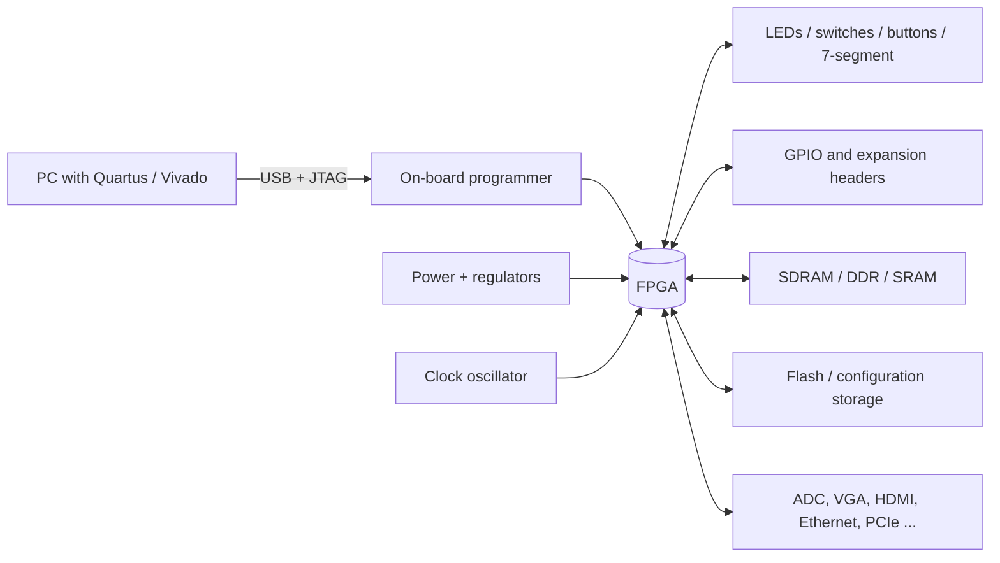
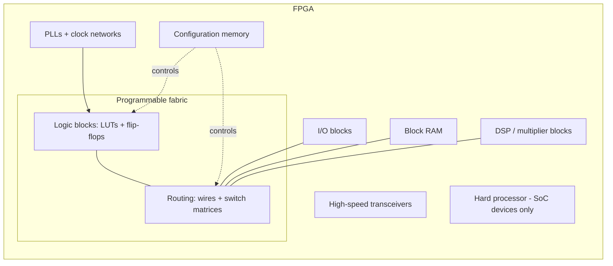
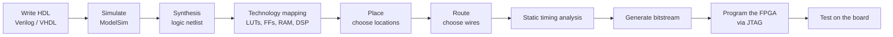
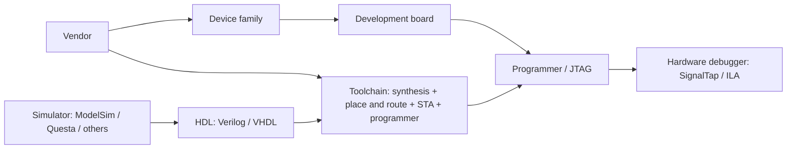

# FPGA Foundations: From the Board to the Circuit (My understanding)

> **Where this file goes:** `docs/theory/fpga-foundations.md` (or `theory/README.md` if your repo uses that layout).
> **Scope:** conceptual foundation only. Digital-logic, HDL, ModelSim and Quartus tutorials live in their own sections; this page links to them rather than repeating them.
> **Sources:** general concepts are standard FPGA knowledge. Board and device specifications must be checked against the official manuals linked in [References](#references). Nothing here is quoted from the Coursera course; the content is a supplementary explanation aligned with the *FPGA Architectures* subject matter of CU Boulder's *Hardware Description Languages for FPGA Design*.

## Contents

1. [What is an FPGA?](#1-what-is-an-fpga)
2. [The development board](#2-the-development-board)
3. [Example boards](#3-example-boards)
4. [A short history](#4-a-short-history)
5. [Types of FPGAs](#5-types-of-fpgas)
6. [FPGA vs other technologies](#6-fpga-vs-other-technologies)
7. [Where FPGAs are used](#7-where-fpgas-are-used)
8. [Inside an FPGA](#8-inside-an-fpga)
9. [From HDL to a working circuit](#9-from-hdl-to-a-working-circuit)
10. [Vendors and toolchains](#10-vendors-and-toolchains)
11. [Glossary](#11-glossary)
12. [References](#references)

---

## 1. What is an FPGA?

A **Field-Programmable Gate Array** is a chip containing a large grid of small, configurable logic elements connected by a configurable routing network. You do not *run a program* on it the way you do on a CPU. You **configure the hardware itself** so that it becomes the digital circuit you described.

- **Why it exists:** custom chips (ASICs) are expensive and slow to produce; CPUs are flexible but execute instructions mostly one after another. An FPGA gives you custom, parallel hardware that you can reprogram.
- **Key idea:** everything described in your HDL runs **concurrently**, as physical circuits, not sequentially as software lines.

Three terms people mix up:

| Term | Meaning | Example |
|---|---|---|
| **FPGA chip** | The silicon device alone | Intel MAX 10 `10M50DAF484C7G` |
| **Development board** | Chip + power, clock, programmer, LEDs, switches, connectors, memory | Terasic DE10-Lite |
| **FPGA-based system** | A product that embeds an FPGA among other parts | A radar front-end, a network card |
| **FPGA accelerator card** | A PCIe card with a large FPGA for servers | Data-centre compute/networking cards |

---

## 2. The development board

A board exists so you can use the chip without designing a PCB. Typical blocks (not every board has all of them):

| Block | Purpose |
|---|---|
| **FPGA + part number** | The device. The part number encodes family, size, package, speed grade. |
| **Power / regulators** | FPGAs need several voltages (core, I/O, auxiliary). |
| **Clock oscillator** | Provides the clock your sequential logic runs on. |
| **GPIO / headers** | Connect external circuits. Voltage levels (I/O standard) matter. |
| **LEDs, switches, buttons, 7-segment** | Simple inputs and outputs for learning. |
| **USB / JTAG** | Programs the FPGA and enables debugging. |
| **RAM** | Larger data storage than the FPGA's internal memory. |
| **Flash** | Stores the configuration so it survives power-off (needed for SRAM-based FPGAs, which lose it). |
| **Peripherals** | ADC, DAC, VGA, HDMI, Ethernet, PCIe, etc., depending on the board. |

**How to read the documents for a board**

| Document | What to look for |
|---|---|
| **User manual** | Block diagram, peripheral list, pin names, how to program. Read this first. |
| **Schematic** | Which FPGA pin connects to which LED, switch or connector. |
| **Device datasheet / handbook** | Resources (logic, memory, DSP), electrical limits, I/O standards. |
| **Pin-constraint file** (`.qsf` in Quartus, `.xdc` in Vivado) | Maps your HDL port names to physical pins. A wrong pin assignment gives a design that compiles but does nothing useful. |

---

## 3. Example boards

Verify every figure against the official page before relying on it.

| Board | FPGA family (vendor) | Notable features | Beginner suitability |
|---|---|---|---|
| **Terasic DE10-Lite** | Intel MAX 10 (`10M50DAF484C7G`) | LEDs, switches, buttons, 7-segment displays, SDRAM, VGA, ADC, accelerometer, Arduino header, on-board USB-Blaster | Very good: Quartus Lite is free, many peripherals, large learning ecosystem |
| **Digilent Arty A7-100T** | AMD Artix-7 (`XC7A100T`) | DDR3 memory, Ethernet, Pmod and Arduino-style headers | Good, with a steeper step into Vivado and larger designs |
| **Sipeed Tang Nano 9K / 20K** | Gowin (GW1NR-9 / GW2AR-18) | Very low cost, HDMI output, small form factor, fewer on-board peripherals | Good for cheap experiments; documentation and tools are less standardized |

Pick a board by: the vendor tool you want to learn, the peripherals your project needs, price, and how good the documentation and community are.

---

## 4. A short history

| Era | Development | Why it mattered |
|---|---|---|
| 1960s-70s | **PROMs** and **PLAs** used as fixed logic | First attempts at implementing logic from programmable memory structures |
| 1970s-80s | **PALs** (e.g. Monolithic Memories), later **GALs** (Lattice) | Reprogrammable two-level logic in a single chip; replaced piles of discrete gates |
| 1980s | **CPLDs / EPLDs** (e.g. Altera) | Several PAL-style blocks joined together; bigger, non-volatile, fast |
| 1985 | **Xilinx XC2064**, widely regarded as the first commercially successful SRAM-based FPGA | A grid of small logic blocks plus programmable routing; far more scalable than PAL-style structures |
| Late 1980s-90s | **Antifuse** FPGAs (Actel) and growing SRAM FPGAs | Antifuse: one-time programmable, secure, radiation-tolerant. SRAM: reprogrammable and fast to scale |
| 2000s | Embedded memory blocks, DSP blocks, PLLs, multi-gigabit transceivers | FPGAs moved from "glue logic" to full signal-processing and communications platforms |
| 2010s | **FPGA SoCs** (e.g. Zynq, Intel SoC FPGAs) with hard ARM processors | Software and hardware on one chip |
| 2010s-present | HBM, AI/ML blocks, heterogeneous "adaptive" devices (e.g. AMD Versal) | Data-centre acceleration, high-bandwidth memory, mixed compute fabrics |
| Industry | Intel acquired Altera (2015); AMD acquired Xilinx (2022) | Large vendors integrated FPGAs into broader compute strategies; check current branding, as vendor structures keep changing |

*Caution:* claims about "the first FPGA" depend on definitions. Treat the XC2064 as "first commercially successful SRAM FPGA", not as the sole origin of programmable logic.

---

## 5. Types of FPGAs

### A. By programming technology

| Type | Configuration stored in | Survives power-off? | Reprogrammable? | Typical use |
|---|---|---|---|---|
| **SRAM-based** | Volatile SRAM cells | No (reloaded from flash or a host at power-up) | Yes, unlimited | Most mainstream FPGAs (Xilinx/AMD, most Intel, Lattice, Gowin) |
| **Flash-based** | Non-volatile flash cells | Yes (instant-on) | Yes (limited cycles) | Low power, instant start, secure designs |
| **Antifuse** | Physical one-time connections | Yes | No | Space, defence, high-reliability |

Practical consequences: SRAM FPGAs need external configuration storage and a short **startup/configuration time**, and the bitstream can be a **security** concern (encryption features exist). Some families (like Intel MAX 10) blur the line with internal flash.

### B. Practical product categories

These are informal categories, not a standard:

- **Entry-level / low-cost:** small logic count, low power (MAX 10, Artix-7 small parts, Tang Nano).
- **Mid-range:** more logic, DSP and memory, some transceivers.
- **High-performance:** huge logic capacity, many fast transceivers, HBM.
- **FPGA SoCs:** FPGA fabric plus hard processor cores on the same chip.
- **Adaptive SoCs:** FPGA fabric plus processors plus specialised engines (e.g. AI engines).

### C. Related terms

- **CPLD:** a few macrocell blocks, non-volatile, very predictable timing, small. FPGAs have far more logic and use LUTs.

---

## 6. FPGA vs other technologies

| | FPGA | CPLD | Microcontroller | CPU | GPU | ASIC |
|---|---|---|---|---|---|---|
| **How it computes** | Custom parallel hardware | Small custom logic | Sequential instructions | Sequential (some parallel) | Massive data-parallel | Fixed custom hardware |
| **Flexibility** | High (reconfigurable) | Medium | High (software) | Very high | Medium | None after fabrication |
| **Latency** | Very low, deterministic | Very low | Higher, depends on code | Higher, OS jitter | Medium to high | Lowest |
| **Power efficiency** | Good for custom tasks | Good | Very good (small tasks) | Moderate | High power | Best per task |
| **Unit cost** | Medium to high | Low | Very low | Medium | High | Very low at volume |
| **Upfront cost / effort** | Medium | Low | Low | Low | Medium | Very high (NRE) |
| **Development difficulty** | High (hardware thinking) | Medium | Low | Low | Medium | Very high |
| **Best when** | Custom parallel logic, low latency, evolving designs | Simple glue logic | Simple control | General computing | Large regular parallel maths | Mass production |

---

## 7. Where FPGAs are used

The pattern for every field: **what is the problem, and why does an FPGA fit better than the alternatives?**

| Field | Problem | Why FPGA | Useful features | Example | When something else is better |
|---|---|---|---|---|---|
| **Telecom / networking** | Process packets at line rate with fixed latency | Parallel pipelines, deterministic timing | Transceivers, DSP, block RAM | Packet filtering in a 100 Gb/s network card | ASIC for fixed, huge-volume switches |
| **DSP** | Filtering/FFT on continuous sample streams | Parallel multiply-accumulate pipelines | DSP slices | FIR filter on an ADC stream | CPU/GPU if latency is not critical |
| **Radar / aerospace** | Real-time beamforming, rad-tolerant control | Massive parallelism, reconfigurable in the field | DSP, transceivers, antifuse/flash for radiation tolerance | Pulse compression in a radar receiver | ASIC for mass-produced systems |
| **Industrial control** | Hard real-time motor/servo control | Deterministic, many I/O in parallel | GPIO, fast logic | Multi-axis motor controller | MCU for simple loops |
| **Medical imaging** | High-throughput image reconstruction | Parallel pipelines, low power at the instrument | DSP, memory | Ultrasound beamforming | GPU for non-embedded reconstruction |
| **Automotive** | Sensor fusion, camera pre-processing | Custom interfaces, functional-safety options | I/O, SoC cores | Camera ISP front-end | Dedicated ASIC for production cars |
| **Finance (HFT)** | Lowest possible latency | Logic runs directly on the network stream | Transceivers, fast fabric | Order-book handling in hardware | CPU for complex strategy logic |
| **Scientific instruments / physics** | Trigger and read out detectors in nanoseconds | Fast, deterministic, reconfigurable | Fabric, TDC-style logic, transceivers | Trigger system of a particle-physics detector | CPU for offline analysis |
| **Vision / image processing** | Per-pixel processing at video rate | Streaming pipelines with tiny latency | Block RAM, DSP | Video colour/LUT processing | GPU for heavy deep-learning workloads |
| **AI / data centre** | Low-latency inference, custom data paths | Custom precision, tight latency | HBM, DSP, adaptive fabric | Inference accelerator | GPU for large-scale training |
| **ASIC prototyping** | Test a chip design before fabrication | Re-programmable emulation | Large capacity | Emulating a new processor | N/A: this is a pre-silicon step |

---

## 8. Inside an FPGA

### The big picture

### Building blocks

| Component | What it does | Why you care |
|---|---|---|
| **LUT (look-up table)** | A small memory (e.g. 4-6 inputs) that can implement any Boolean function of its inputs | Synthesis reports "LUTs used" |
| **Flip-flop / register** | Stores one bit on a clock edge | Every sequential design uses them |
| **Logic block** | LUTs + flip-flops + extra logic (carry chains, muxes) | Called **CLB/slice** (AMD), **LAB/logic element** (Intel), **logic cell/slice** (Lattice, Gowin). Names and details vary by vendor |
| **Programmable routing** | Wires with switches (switch matrices, connection boxes) that join logic blocks | Routing delay often dominates timing |
| **I/O blocks (IOB)** | Interface pins to the outside world; support I/O standards (3.3 V LVCMOS, LVDS, ...) | Pin planning and voltage compatibility |
| **Clock networks + PLLs** | Distribute clocks with low skew; PLLs multiply, divide and phase-shift clocks | Clock constraints, clock domains |
| **Block RAM** | Dedicated on-chip memory | Inferred from memory-like HDL |
| **DSP blocks** | Hardwired multiplier-accumulators | Inferred from `*` in arithmetic code |
| **Transceivers** | Multi-gigabit serial links (PCIe, Ethernet) | High-end boards only |
| **Configuration memory** | Cells that hold the bitstream and decide how LUTs and routes behave | This is what "programming" writes |
| **Hard processor system** | Real ARM cores next to the fabric | SoC FPGAs only |

### Building up one idea at a time

**Step 1: A Boolean function.** `Y = A·B` (an AND gate).

**Step 2: A LUT implements it.** A 2-input LUT is a 4-entry memory holding the truth table. The inputs act as the address:

| A | B | Stored value (Y) |
|---|---|---|
| 0 | 0 | 0 |
| 0 | 1 | 0 |
| 1 | 0 | 0 |
| 1 | 1 | 1 |

Any other 2-input function is the same LUT with different stored bits. A multiplexer (`Y = S ? B : A`) is a 3-input function, so it also fits in a single LUT.

**Step 3: A flip-flop stores state.** On each clock edge it captures its input. A **counter** is a register plus an adder: the LUTs compute `count + 1`, the flip-flop holds `count`.

**Step 4: Combinational vs sequential.**
- *Combinational:* output depends only on current inputs (LUT only).
- *Sequential:* output also depends on stored state (LUT + flip-flop).

An **FSM** is a state register plus next-state logic plus output logic: the register is flip-flops, the logic is LUTs.

**Step 5: Routing connects the pieces.** The output of one LUT travels along programmable wires, through switch matrices, to the inputs of other logic blocks.

**Step 6: Clocks coordinate everything.** All flip-flops in a clock domain update on the same edge. Between two flip-flops, the logic and routing delay must be shorter than the clock period (this is what *setup time* checks).

**Step 7: Synthesis and implementation map your HDL onto these resources** (next section).

*Related tutorials in this repo:* [combinational logic](../../01-combinational) and [sequential logic](../../02-sequential).

---

## 9. From HDL to a working circuit

| Stage | What happens | Common issues |
|---|---|---|
| **Write HDL** | You describe hardware behaviour and structure | Writing code that looks like software but cannot be built as hardware |
| **Simulation** | A simulator runs your HDL and testbench to check behaviour (the model is idealized; no real timing) | Missing test cases |
| **Synthesis** | Converts HDL into generic logic gates and registers | Unintended latches, unused logic removed |
| **Technology mapping** | Fits that logic into the device's real LUTs, flip-flops, RAM, DSP blocks | Resource limits |
| **Placement** | Chooses where each element sits on the chip | Congestion |
| **Routing** | Chooses the wires and switches that connect them | Long routes hurt timing |
| **Static timing analysis (STA)** | Checks all paths against your clock constraint (setup/hold) | Negative slack = timing failure |
| **Bitstream generation** | Produces the configuration file (`.sof`, `.bit`, ...) | Missing pin assignments |
| **Programming** | Loads the bitstream into the device (JTAG) or flash | Wrong device selected |
| **On-board test** | Verify real inputs and outputs | Behaviour differs from simulation |

**Why simulation is not enough.** Simulation proves your *logic* is right for the stimulus you gave it. It does not prove real timing is met after placement and routing, that the pin assignments and voltage levels are correct, that asynchronous inputs (buttons, external signals) are handled safely, or that clocks, power and the physical board behave as expected.

**What tools infer, and what they do not.** Tools infer structure from your coding style: registers from clocked processes/always blocks, RAM from certain array patterns, multipliers from `*`. They do not infer your *intent*: if you forget a reset, forget a default assignment, or write a combinational loop, the tool builds exactly what you wrote.

**HDL is not software.** Verilog and VHDL describe circuits that all exist and operate at the same time. Statements are not executed top to bottom by a processor; the order of independent statements does not matter in the final hardware.

### Concepts you will meet immediately

| Concept | Meaning |
|---|---|
| **Concurrency** | All circuit parts operate simultaneously |
| **Clock domain** | A group of flip-flops driven by the same clock |
| **Setup time** | Data must be stable *before* the clock edge |
| **Hold time** | Data must stay stable *after* the clock edge |
| **Propagation delay** | Time for a signal to pass through logic and routing |
| **Timing constraint** | The clock frequency and I/O timing you tell the tools to meet (an `.sdc` file in Quartus) |
| **Pin assignment** | Maps HDL ports to physical FPGA pins |
| **Utilization** | How much of the device's LUTs, flip-flops, RAM and DSP your design uses |

---

## 10. Vendors and toolchains

| Vendor | Typical device families | Main tools |
|---|---|---|
| **AMD (Xilinx)** | Artix, Kintex, Virtex, Zynq, Versal | Vivado (also Vitis for software) |
| **Intel FPGA (Altera)** | MAX 10, Cyclone, Arria, Stratix, Agilex | Quartus Prime (Lite is free) |
| **Lattice** | iCE40, ECP5, Nexus | Radiant, Diamond; open-source toolchains also exist for some parts |
| **Microchip** | PolarFire, IGLOO2 (flash-based) | Libero |
| **Gowin** | LittleBee, Arora (Tang Nano boards) | Gowin EDA |

**How the pieces relate:**

- **ModelSim vs Questa:** Intel's bundled simulator edition has changed names across versions; check which one your Quartus installation includes.
- Tool and device support changes between versions; always check the vendor's current documentation.

*Your own setup:* VHDL/Verilog, ModelSim, Quartus Prime Lite, DE10-Lite (MAX 10).

---

## 11. Glossary

| Term | Definition |
|---|---|
| **ASIC** | Application-specific integrated circuit: a chip built for one purpose |
| **Bitstream** | The configuration file that sets up the FPGA's logic and routing |
| **CLB / LAB / slice** | Vendor-specific names for a group of LUTs and flip-flops |
| **CPLD** | Complex programmable logic device: small, non-volatile programmable logic |
| **DSP block** | Hardwired multiply-accumulate unit |
| **Flip-flop** | One-bit storage element updated on a clock edge |
| **HDL** | Hardware description language (Verilog, VHDL) |
| **I/O standard** | Electrical signalling rule for a pin (e.g. LVCMOS33, LVDS) |
| **JTAG** | Standard test/programming interface |
| **LUT** | Look-up table: small memory implementing any Boolean function |
| **Netlist** | Description of circuit elements and their connections |
| **PLL** | Phase-locked loop: generates and adjusts clock frequencies |
| **Place and route** | Placing logic on the chip and choosing connecting wires |
| **SoC FPGA** | FPGA fabric combined with hard processor cores |
| **STA** | Static timing analysis |
| **Synthesis** | Converting HDL into logic elements |
| **Transceiver** | High-speed serial communication block |

---

## References

**Verify all device and board facts here before publishing them as final.**

- Terasic DE10-Lite: Terasic product page and the DE10-Lite User Manual (https://www.terasic.com.tw/)
- Intel MAX 10 FPGA device documentation (Intel/Altera documentation portal)
- Digilent Arty A7 reference manual: https://digilent.com/reference/programmable-logic/arty-a7/start
- AMD Artix-7 data sheet (DS181) and 7 Series FPGAs documentation (AMD documentation portal)
- Sipeed Tang Nano 9K: https://wiki.sipeed.com/hardware/en/tang/tang-nano-9k/nano-9k.html
- Sipeed Tang Nano 20K: https://wiki.sipeed.com/hardware/en/tang/tang-nano-20k/nano-20k.html
- Gowin Semiconductor device datasheets (https://www.gowinsemi.com/)
- Quartus Prime user guides (Intel/Altera documentation portal)
- Vivado Design Suite user guides (AMD documentation portal)
- Course (reference for subject alignment only): *Hardware Description Languages for FPGA Design*, University of Colorado Boulder, on Coursera. Not quoted here; no course content was accessed.
- Historical items (XC2064, Altera/Intel and AMD/Xilinx acquisitions, Zynq and Versal launches): confirm dates against vendor press releases or a reliable history such as the Computer History Museum.
